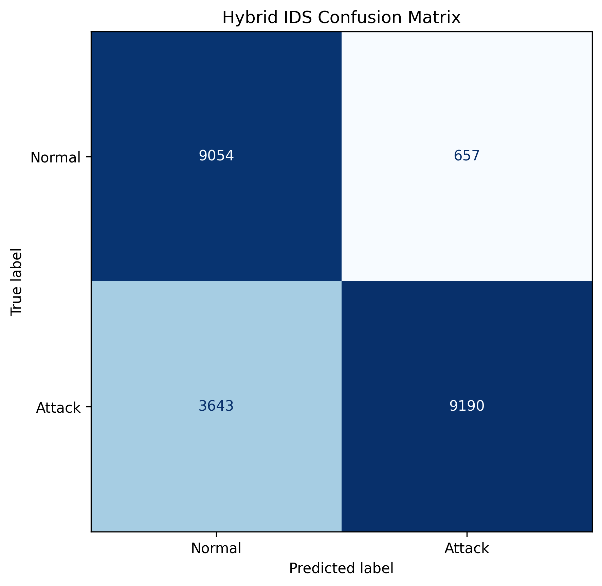
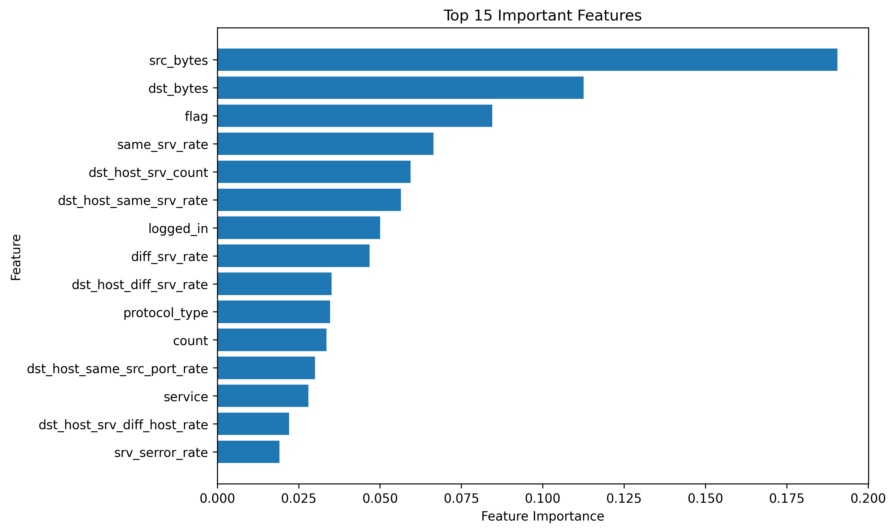
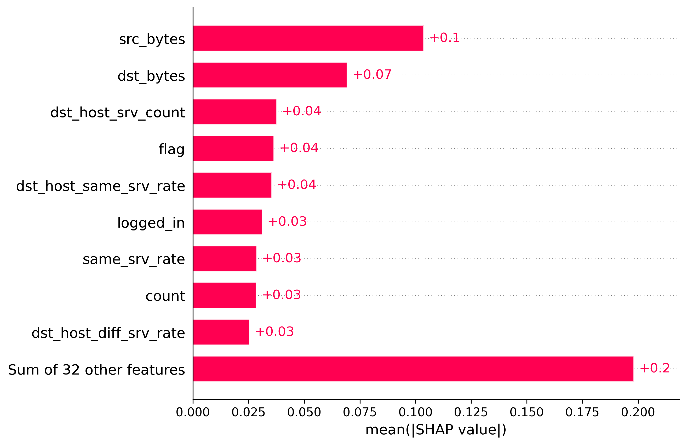
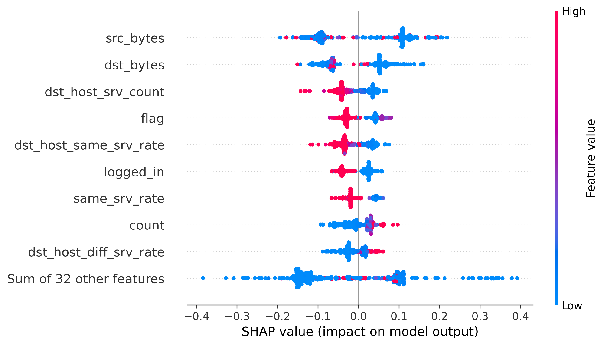

# Hybrid Network Intrusion Detection System

A modular and explainable Hybrid Network Intrusion Detection System (IDS) that combines machine learning and rule-based detection for network attack classification using the NSL-KDD dataset.

The system combines Random Forest, Logistic Regression, and an adaptive Rule Engine through a weighted decision fusion strategy. SHAP is used to analyze the contribution of individual features to the Random Forest predictions.

---

## Features

- Modular Python project architecture
- Random Forest classifier
- Logistic Regression classifier
- Adaptive rule-based detector
- Weighted hybrid ensemble
- Confidence score estimation
- SHAP-based model explainability
- Feature importance analysis
- Confusion matrix visualization
- Error analysis
- Automated evaluation and reporting

---

## Dataset

This project uses the **NSL-KDD** benchmark dataset for network intrusion detection.

The dataset is **not included** in this repository.

Download the following files and place them inside the `data/` directory:

```text
KDDTrain+.txt
KDDTest+.txt
```

The repository already includes:

```text
feature_names.txt
```

The system performs binary classification:

- `0` — Normal
- `1` — Attack

---

# Methodology

The IDS consists of four major components.

## 1. Data Preprocessing

The preprocessing pipeline includes:

- Loading the NSL-KDD dataset
- Assigning feature names
- Handling categorical features through label encoding
- Handling missing values
- Preparing training and testing features
- Binary attack classification
- Feature scaling for Logistic Regression

---

## 2. Machine Learning Models

### Random Forest

A Random Forest classifier is used as the primary tree-based model.

It also provides feature importance values that are used for model interpretation.

### Logistic Regression

Logistic Regression provides a complementary linear classification model.

The input features are standardized before training.

---

## 3. Rule-Based Detector

A lightweight adaptive rule engine provides an additional heuristic signal for intrusion detection.

The rule engine uses selected network traffic features and thresholds derived from the training data. The resulting rule prediction is incorporated into the final hybrid decision.

---

## 4. Hybrid Ensemble

The predictions from the three components are combined using a weighted decision fusion strategy:

| Component | Weight |
|-----------|-------:|
| Random Forest | 0.60 |
| Logistic Regression | 0.30 |
| Rule Engine | 0.10 |

The system also calculates a confidence score for each final prediction.

The hybrid decision threshold was reduced from the initial `0.50` operating point to `0.30` to improve attack detection recall and the overall precision-recall trade-off.

---

# Results

The Hybrid IDS was evaluated on the **NSL-KDD test dataset containing 22,544 test samples**.

### Model Performance

| Model | Accuracy | Precision | Recall | F1-score |
|-------|---------:|----------:|-------:|---------:|
| Random Forest | 77% | 97% | 62% | 75% |
| Logistic Regression | 76% | 92% | 62% | 74% |
| **Hybrid IDS** | **81%** | **93%** | **72%** | **81%** |

The Hybrid IDS currently provides the strongest overall performance among the evaluated models, particularly in terms of attack recall and F1-score.

### Hybrid IDS Performance

| Metric | Hybrid IDS |
|--------|-----------:|
| Accuracy | **80.93%** |
| Precision | **93.33%** |
| Recall | **71.61%** |
| F1-score | **81.04%** |

The Hybrid IDS correctly classified **18,244** out of 22,544 test samples.

The evaluation produced:

- **4,300** incorrect predictions
- **657** false positives
- **3,643** false negatives

Compared with the original `0.50` decision threshold, the updated threshold substantially reduced false negatives while maintaining relatively high attack precision.

### Hybrid IDS Confusion Matrix



---

## Error Analysis

Error analysis is used to examine the false-positive and false-negative behavior of the Hybrid IDS.

At the current operating point:

| Error Type | Count |
|------------|------:|
| False Positives | 657 |
| False Negatives | 3,643 |
| Total Errors | 4,300 |

The reduction in false negatives indicates improved detection of attack traffic compared with the original hybrid configuration.

Further analysis of model disagreements is used to identify cases where Random Forest, Logistic Regression, and the Rule Engine produce different predictions.

---

## Feature Importance

Random Forest feature importance is used to identify the features that contribute most strongly to the model's predictions.



---

# Explainability

The project integrates **SHAP (SHapley Additive exPlanations)** to analyze the contribution of individual features to Random Forest predictions.

### SHAP Feature Importance



### SHAP Feature Impact



SHAP waterfall plots are also generated for individual predictions.

---

# Installation

Clone the repository:

```bash
git clone https://github.com/tamaghnakundu/network-intrusion-detection.git
cd network-intrusion-detection
```

Install the required dependencies:

```bash
pip install -r requirements.txt
```

---

# Usage

After downloading the NSL-KDD dataset and placing the required files in the `data/` directory, run:

```bash
python main.py
```

The pipeline:

1. Loads the dataset
2. Preprocesses the data
3. Trains the Random Forest model
4. Trains the Logistic Regression model
5. Runs the rule-based detector
6. Generates hybrid predictions
7. Evaluates model performance
8. Performs error analysis
9. Generates feature importance visualizations
10. Generates SHAP explanations
11. Saves reports and generated outputs

Automatically generated files are written to the `outputs/` directory.

---

# Technologies Used

- Python
- Scikit-learn
- SHAP
- Pandas
- NumPy
- Matplotlib
- Joblib

---

# Future Improvements

- Evaluation on modern intrusion detection datasets
- Further false-positive and false-negative analysis
- Improved hybrid decision fusion
- Systematic threshold and weight optimization
- Deep learning-based intrusion detection
- Real-time network traffic analysis
- Extended explainability for the hybrid ensemble
- Streaming intrusion detection